<p align="center">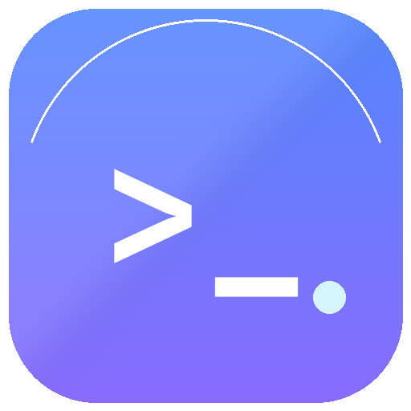</p>

# Luma Terminal

一个 **macOS 风格、现代化、支持分屏** 的 Linux 终端。

- **VT 内核**：`libghostty-vt`（从 Ghostty 终端内核提取的 C 库），负责 PTY 输出解析、屏幕状态、滚动回看、选择、搜索以及键盘/鼠标编码。
- **界面**：Qt 6 / Qt Quick（QML）手写，无 Electron、无 WebView。
- **渲染**：Qt Quick `QQuickPaintedItem` + QPainter，自绘终端网格，透明单元格背景让 QML 的玻璃质感透过来。

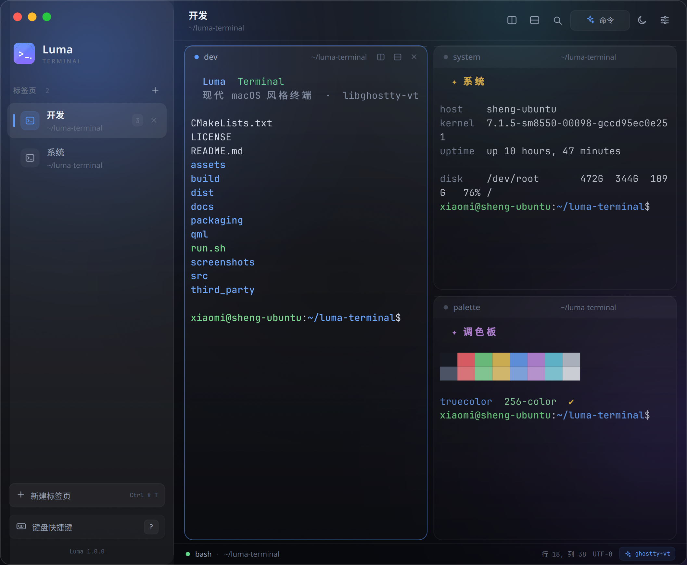

## 功能

| 能力 | 状态 |
| --- | --- |
| 真实 PTY 交互 Shell、窗口尺寸同步 | 已实现 |
| UTF-8、宽字符、组合字符、真彩色 / 256 色 | 已实现 |
| 备用屏幕（vim/htop 等）、光标形状与闪烁 | 已实现 |
| 标签页（新建 / 关闭 / 切换） | 已实现 |
| 任意层级横向 / 纵向分屏、拖动分隔线 | 已实现 |
| 滚动回看（8000 行）、滚轮 / 翻页 / 跳转 | 已实现 |
| 搜索、全部匹配高亮、上一个 / 下一个 | 已实现 |
| 鼠标拖选、双击选词、三击选行、全选、复制 | 已实现 |
| 粘贴（bracketed paste / 安全处理交给 libghostty-vt） | 已实现 |
| 字体缩放 | 已实现 |
| IME（中文输入法提交与候选项定位） | 已实现 |
| 鼠标上报、焦点上报（由 libghostty-vt 编码） | 已实现 |
| OSC 标题、OSC 7 工作目录、`/proc` 回退 | 已实现 |
| 深色 / 浅色主题，设置面板，自动持久化 | 已实现 |
| 标签重命名、右键菜单上移 / 下移标签 | 已实现 |
| OSC 52 应用剪贴板读写 | 已实现 |
| OSC 8 超链接（`Ctrl + 单击`打开） | 已实现 |
| 桌面通知（OSC 9 / OSC 777） | 已实现 |
| 窗口大小、字号、主题、Shell、回看行数持久化 | 已实现 |
| 无边框窗口、macOS 红黄绿交通灯、圆角与玻璃侧栏 | 已实现 |
| 命令面板、快捷键帮助、轻提示 | 已实现 |
| 独立应用图标、桌面项、`.deb` / 便携包 | 已实现 |
| 标签拖拽排序、会话恢复、Kitty 图片、ligatures | 暂未实现 |

### 界面预览

| 命令面板 | 终端内查找 |
| --- | --- |
| 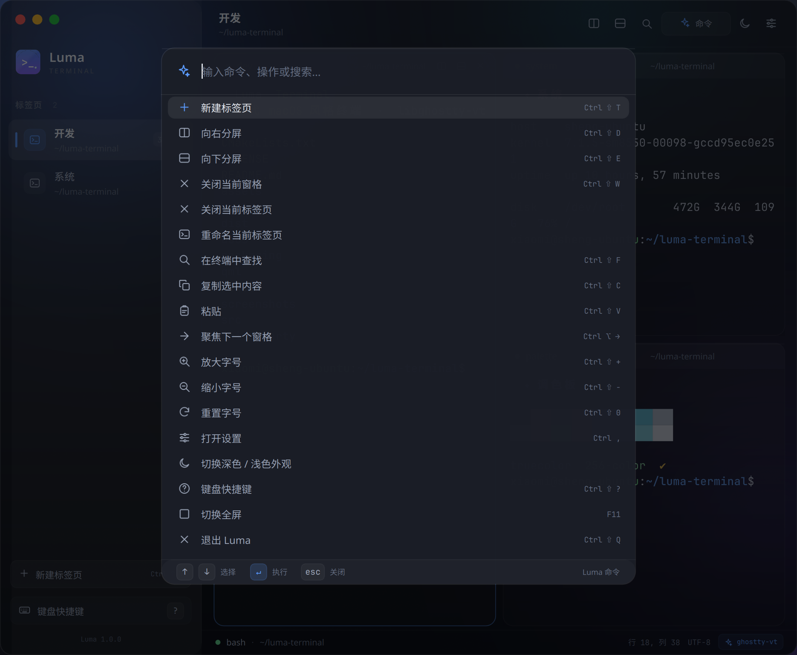 | 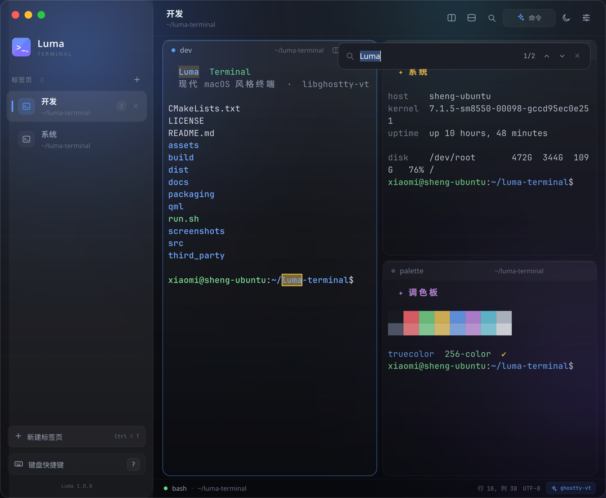 |

| 快捷键帮助 | 全选 / 复制 |
| --- | --- |
| 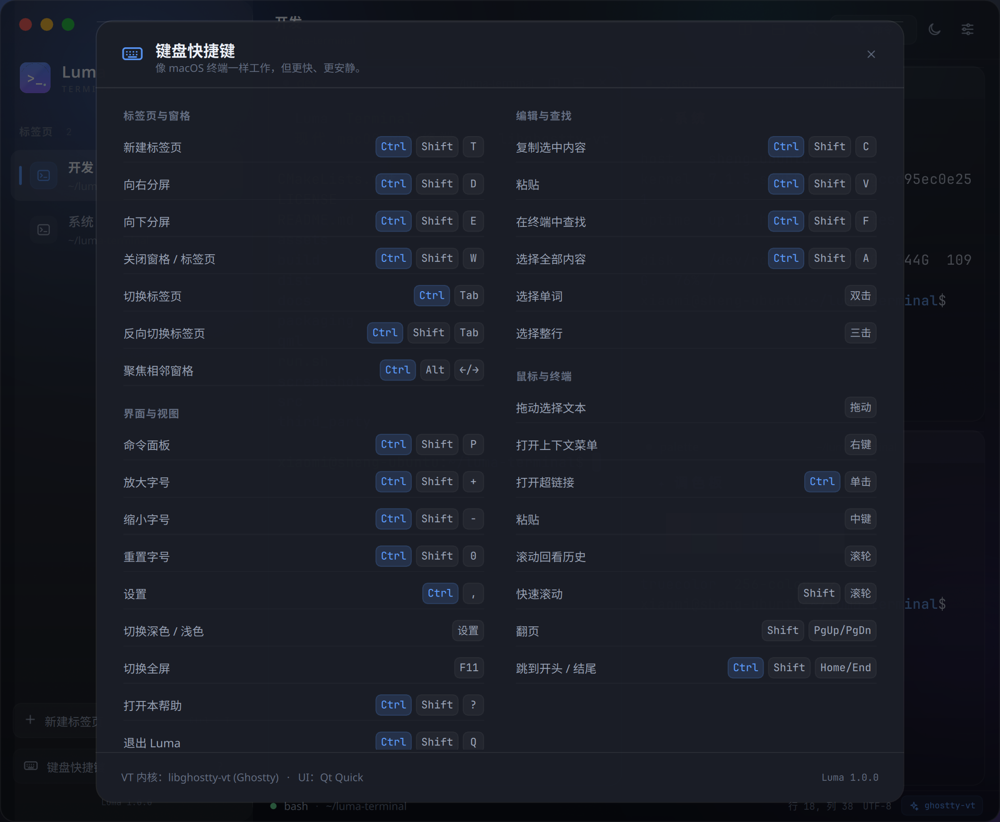 | 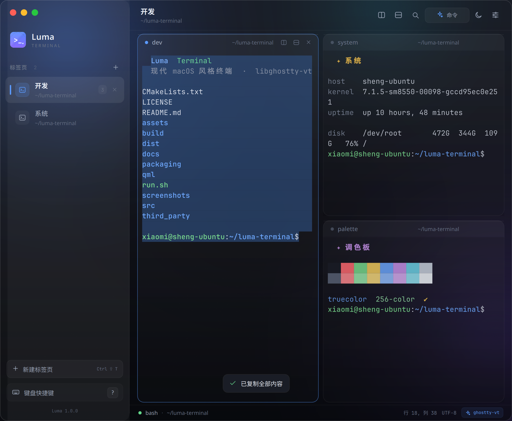 |

| 历史回看与「回到底部」 | 多标签会话 |
| --- | --- |
| 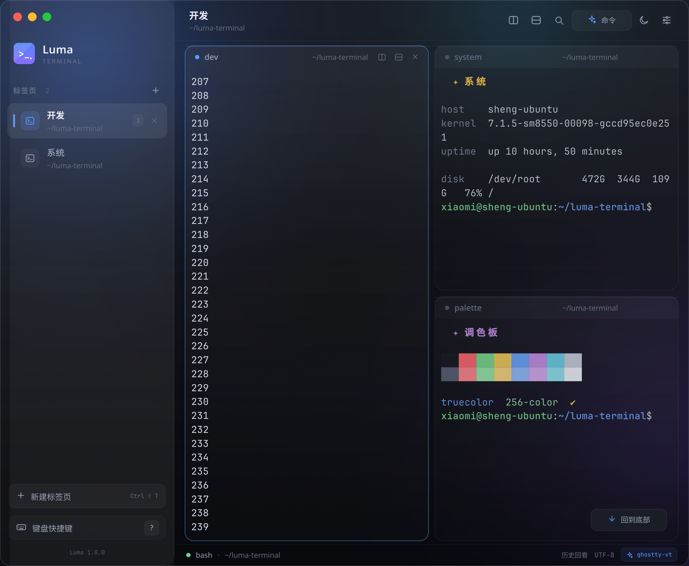 | 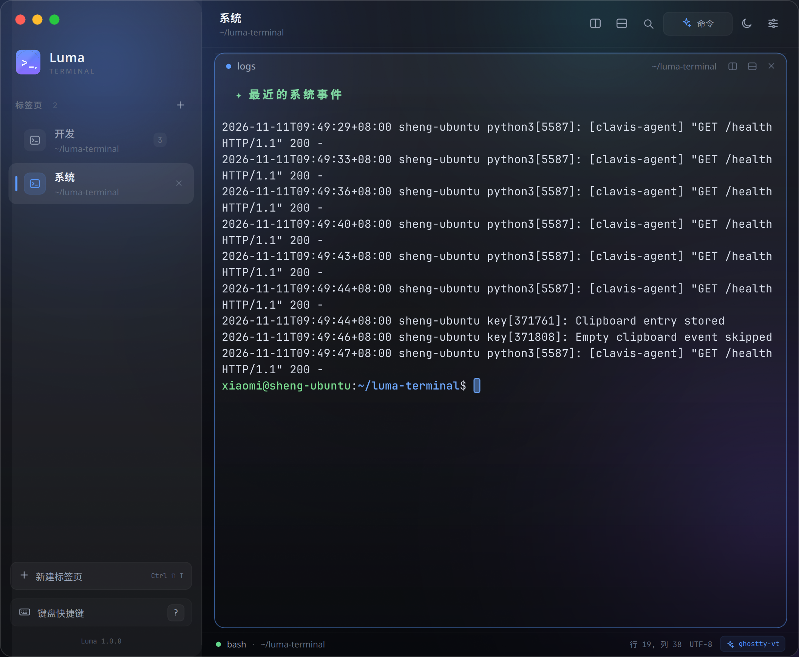 |

| 设置面板 | 浅色主题 |
| --- | --- |
| 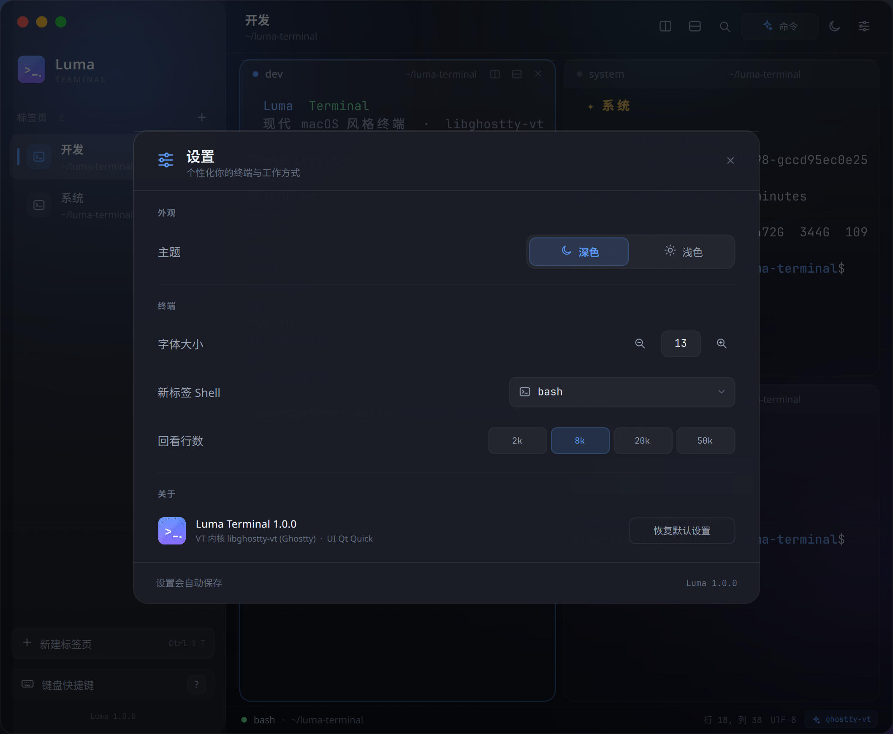 | 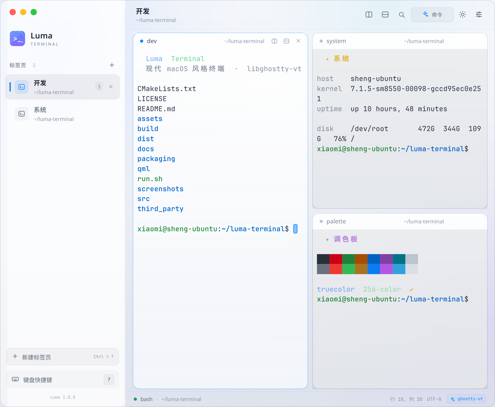 |

| 重命名标签页 | 浅色设置 |
| --- | --- |
| 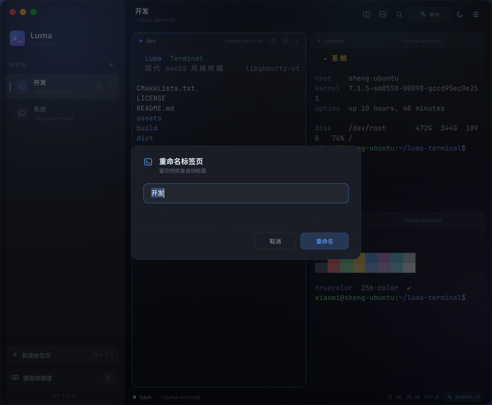 | 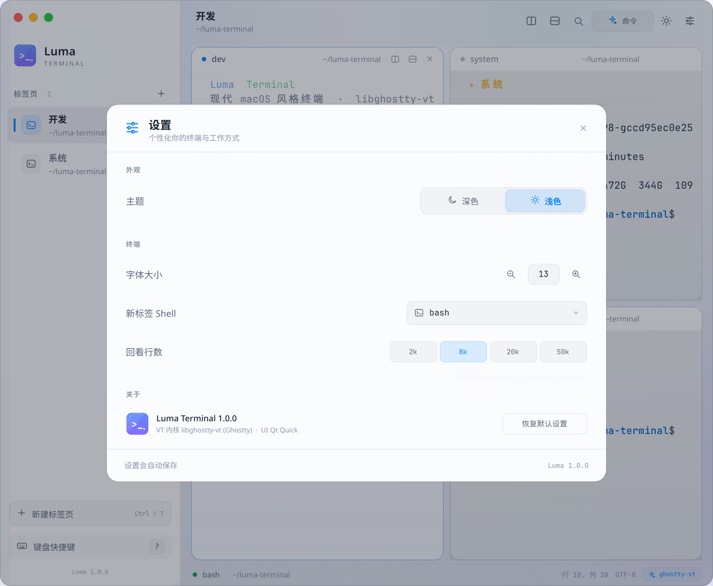 |

## 快速开始

环境要求：Linux（已在 Ubuntu 26.04 aarch64 + Wayland 验证）、Qt 6.8+、CMake 3.22+、Ninja、g++。

```bash
sudo apt install cmake ninja-build g++ \
  qt6-base-dev qt6-declarative-dev qt6-svg-dev \
  qml6-module-qtquick qml6-module-qtquick-controls \
  qml6-module-qtquick-window qml6-module-qtquick-effects \
  qml6-module-qtcore

cmake -G Ninja -B build -DCMAKE_BUILD_TYPE=Release
cmake --build build

./build/luma
```

`libghostty-vt` 的头文件和共享库已经放在 `third_party/libghostty/`，不需要额外安装；项目**没有使用 libvterm**。

演示模式会打开一个三窗格 + 双标签的完整界面：

```bash
./build/luma --demo
```

安装到本地前缀：

```bash
cmake --install build --prefix "$HOME/.local"
~/.local/bin/luma
```

或者打包成可分发应用（自动生成 deb + 便携 tar.gz）：

```bash
./packaging/build-package.sh
# dist/luma-terminal_1.0.0_arm64.deb
# dist/luma-terminal-1.0.0-linux-arm64.tar.gz
```

安装 deb（会同时安装桌面项和图标）：

```bash
sudo apt install ./dist/luma-terminal_1.0.0_arm64.deb
```

便携包解压后直接运行：

```bash
tar -xzf dist/luma-terminal-1.0.0-linux-arm64.tar.gz
./luma-terminal-1.0.0-linux-arm64/bin/luma
```

也可以直接使用 `./run.sh`（自动构建并启动）。

### 开发/截图参数

```bash
./build/luma --demo --screenshot /tmp/luma.png
./build/luma --demo --screenshot /tmp/palette.png --screenshot-ui palette
# --screenshot-ui: palette | help | search | selection | tab2
#                  settings | rename | light | light-settings | dark
```

## 快捷键

| 操作 | 快捷键 |
| --- | --- |
| 新建标签页 | `Ctrl Shift T` |
| 关闭窗格 / 标签页 | `Ctrl Shift W` |
| 向右分屏 | `Ctrl Shift D` |
| 向下分屏 | `Ctrl Shift E` |
| 切换标签页 | `Ctrl Tab` / `Ctrl Shift Tab` |
| 聚焦相邻窗格 | `Ctrl Alt ←/→` |
| 在终端中查找 | `Ctrl Shift F` |
| 复制 / 粘贴 | `Ctrl Shift C` / `Ctrl Shift V` |
| 全选 | `Ctrl Shift A` |
| 命令面板 | `Ctrl Shift P` 或 `Ctrl Shift K` |
| 设置 | `Ctrl ,` |
| 切换深色 / 浅色 | 设置或命令面板 |
| 放大 / 缩小 / 重置字号 | `Ctrl Shift +` / `Ctrl Shift -` / `Ctrl Shift 0` |
| 打开链接 | `Ctrl + 单击` |
| 快捷键帮助 | `Ctrl Shift ?` |
| 全屏 | `F11` |
| 退出 | `Ctrl Shift Q` |
| 上 / 下翻页 | `Shift PgUp` / `Shift PgDn` |
| 跳到历史开头 / 回到最新 | `Ctrl Shift Home` / `Ctrl Shift End` |

鼠标：滚轮回看历史，`Shift + 滚轮` 快速滚动；双击选词，三击选行；右键打开上下文菜单；中键粘贴；`Ctrl + 单击`打开超链接。标签页右键菜单支持重命名、上移、下移和关闭。

## 架构

```
src/
  main.cpp              Qt Quick 启动、CLI、QML 注册
  TerminalSession.*     PTY + libghostty-vt 状态、渲染快照、选择/搜索/输入编码
  TerminalView.*        QQuickPaintedItem 渲染、键盘/IME/鼠标/滚轮
  TerminalManager.*     会话注册与标题/目录/退出/铃声转发
  Theme.*               深色/浅色颜色、字体、终端调色板
qml/
  Main.qml              窗口、侧栏、标签页、分屏模型、命令面板/帮助/查找入口
  components/           交通灯、图标、按钮、键帽、侧栏标签
  panes/                递归分屏、终端窗格、上下文菜单
  overlays/             搜索条、命令面板、快捷键帮助、设置、重命名、Toast
packaging/              .deb / 便携包构建脚本与桌面项
third_party/libghostty/ libghostty-vt 头文件与运行时库（MIT）
assets/                 背景、应用图标（PNG + SVG）、SVG 图标
```

### 关键实现说明

- **解析与状态**：所有 VT 序列、备用屏幕、滚动回看、重排、选择、搜索都交给 `libghostty-vt`，Qt 侧只读 `GhosttyRenderState`。
- **渲染快照**：每个刷新周期把 render state 的单元格、样式、选择范围、搜索匹配复制成轻量快照，再由 QPainter 绘制；避免在 `paint()` 中直接依赖易失的 C 句柄。
- **输入**：键盘和鼠标通过 `ghostty_key_encoder` / `ghostty_mouse_encoder` 编码，自动跟随应用光标键模式、Kitty 键盘协议、鼠标跟踪模式；粘贴通过 `ghostty_terminal_paste()` 处理 bracketed paste。
- **窗口**：Wayland/X11 下使用无边框窗口；交通灯、拖拽、边缘缩放均为自绘/系统窗口 API。
- **侧栏**：竖向标签页显示标题、工作目录与窗格数量；激活窗格使用蓝色描边，非激活窗格轻微压暗。

## 调研与取舍

终端功能调研、竞品对照和实现边界见 [`docs/RESEARCH.md`](docs/RESEARCH.md)。

## 已知边界

- 标签页暂不支持拖拽排序，但支持右键菜单重命名 / 上移 / 下移。
- 暂不支持会话/窗口布局恢复、Kitty 图片协议渲染、ligatures、多窗口。
- 主题为深色 / 浅色两套；未提供任意自定义配色。
- `libghostty-vt` 使用当前系统打包的 C ABI 版本（0.1 ABI，来自 Ghostty 1.4）；库源码与许可证见 `third_party/libghostty/`。
- 桌面通知通过 `notify-send` 发送；未安装时会静默降级为应用内 Toast。
- 在部分桌面环境中，开发目录直接启动可能产生一条无害的 xdg-desktop-portal 警告；安装后桌面项会正常注册。

## 许可

本项目代码采用 MIT License。`libghostty-vt` 为 MIT License，见 `third_party/libghostty/COPYRIGHT`。
